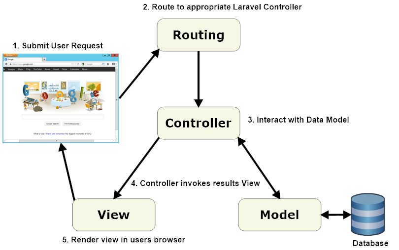

# Real Estate MVC

Real Estate MVC is a PHP real estate web application built with a simple MVC structure, Twig templates, and Illuminate/Eloquent for database access. The project runs locally with XAMPP and uses MySQL through phpMyAdmin.

The public landing page is designed for visitors to browse properties, search listings, learn about services and contact the agency. The protected admin dashboard lets logged-in users manage listings, agents, users, locations, property types and amenities.

## Features

- Modern public landing page with hero section, search panel, featured listings, services, agents and contact form.
- Public search for listings by location/address, property type and budget.
- Admin dashboard protected by login/session checks.
- Dashboard listing search by address, description, agent or property type.
- CRUD modules for:
  - Listings
  - Agents
  - Users
  - Locations
  - Property types
  - Amenities
- Contact form submissions saved in the database.
- Twig-based views with reusable layouts.
- Eloquent models and relationships for listings, agents, property types and amenities.

## Tech Stack

- PHP 8+
- XAMPP / Apache
- MySQL / phpMyAdmin
- Composer
- Twig
- Illuminate Database / Eloquent
- Bootstrap
- Custom CSS

## Project Structure

```text
realestate/
+-- App/
|   +-- Controllers/      # Application controllers
|   +-- Helper/           # Session helper
|   +-- Models/           # Eloquent models
|   +-- Views/            # Twig templates and layouts
+-- Core/                 # Router, Controller, View, Error handling
+-- database/             # Migration scripts and SQL import file
+-- public/               # Entry point, routes, CSS, JS, images
+-- Bootstrap.php         # Eloquent/Capsule bootstrapping
+-- composer.json
+-- README.md
```

## Local Setup with XAMPP

1. Copy the project folder to:

   ```text
   C:\xampp\htdocs\realestate
   ```

2. Start Apache and MySQL from XAMPP Control Panel.

3. Open phpMyAdmin:

   ```text
   http://localhost/phpmyadmin
   ```

4. Import the prepared SQL file:

   ```text
   database/realestate_import.sql
   ```

   This creates the `realestate` database, tables and demo data.

5. Open the app:

   ```text
   http://localhost/realestate/public/
   ```

## Admin Login

After importing `database/realestate_import.sql`, use:

```text
Email: admin@realestate.test
Password: admin123
```

## Important URLs

```text
Public landing page:
http://localhost/realestate/public/

Public listings/search:
http://localhost/realestate/public/buy

Login:
http://localhost/realestate/public/login

Admin dashboard/listings:
http://localhost/realestate/public/listings
```

## Database Configuration

Database settings are in:

```text
App/Config.php
```

Default local configuration:

```php
const DB_HOST = '127.0.0.1';
const DB_NAME = 'realestate';
const DB_USER = 'root';
const DB_PASSWORD = '';
```

## Notes for GitHub

The repository includes a `.gitignore` that excludes local/runtime files such as:

- `vendor/`
- `.idea/`
- logs
- runtime uploads
- ZIP exports
- OS/editor files

After cloning the project, install PHP dependencies with:

```bash
composer install
```

## Deployment Note

This project is currently a PHP + MySQL application designed for Apache/XAMPP-style hosting. Vercel does not run traditional PHP/MySQL apps directly like XAMPP.

For live deployment, use one of these options:

- PHP/MySQL hosting such as cPanel hosting, InfinityFree, 000webhost-style hosting, Hostinger, etc.
- A VPS with Apache/Nginx, PHP and MySQL.
- Refactor later into a separate frontend and backend if you specifically want Vercel.

## MVC Diagram


